# Myriad Frame

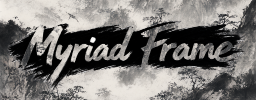

An Electron + Vue 3 + TypeScript desktop front-end that uses [`stable-diffusion.cpp`](https://github.com/leejet/stable-diffusion.cpp) as its runtime provider. It manages sessions, downloads and selects models (diffusion / VAE / text encoder) from curated Hugging Face repositories, and drives image generation through the bundled `sd-cli` runtime.

🌐 **Project website**: [lemuelmc.github.io/myriad-frame](https://lemuelmc.github.io/myriad-frame)

## Support

Myriad Frame is a free, open-source project. If you find it useful and would like to support its development, you can buy me a coffee:

[](https://buymeacoffee.com/lemuel.raganas)

## Runtime & Model Providers

- **Runtime**: [`stable-diffusion.cpp`](https://github.com/leejet/stable-diffusion.cpp) by @leejet — a C++ port of Stable Diffusion, optimized for speed and low memory usage.
- **Model Providers** — models are downloaded from [Hugging Face](https://huggingface.co) and [CivitAI](https://civitai.com). The full list is maintained in [`configurations/hub.json`](configurations/hub.json).

**Hugging Face** _(click to expand)_:
<details>
<summary>Providers</summary>

- **[Unsloth](https://huggingface.co/unsloth)** — quantized diffusion models, VAEs, and text encoders.
- **[Abenzerps](https://huggingface.co/abenzerps)** — community diffusion model quantizations.
- **[Black Forest Labs](https://huggingface.co/black-forest-labs)** — official FLUX checkpoints and VAEs.
- **[Qwen](https://huggingface.co/Qwen)** — Qwen text encoders.
- **[City 96](https://huggingface.co/city96)** — distilled SD3.5 / FLUX.2 GGUF quantizations, T5 encoders.
- **[huaweilin](https://huggingface.co/huaweilin)** — SD3.5 VAE.
- **[Comfy-Org](https://huggingface.co/Comfy-Org)** — split-file model bundles (Z-Image, Wan, Qwen-Image, MOSS-Image).
- **[Rebel AI](https://huggingface.co/realrebelai)** — Krea 2 Turbo GGUF.
- **[Stability AI](https://huggingface.co/stabilityai)** — official SDXL checkpoints.
- **[CircleStone Labs](https://huggingface.co/circlestone-labs)** — Anima model.
- **[RunDiffusion](https://huggingface.co/RunDiffusion)** — Juggernaut-XL SDXL finetunes.
- **[Krea](https://huggingface.co/krea)** — Krea 2 LoRAs.
- **[Unmods](https://huggingface.co/UntMods)** — Krea 2 character LoRAs.
- **[Diffusers](https://huggingface.co/diffusers)** — SDXL inpainting model.
- **[leejet](https://huggingface.co/leejet)** — GGUF quantizations (FLUX, Z-Image, MOSS-Image).
- **[comfyanonymous](https://huggingface.co/comfyanonymous)** — FLUX text encoders.
- **[QuantStack](https://huggingface.co/QuantStack)** — Wan2.2 / FLUX.1-Kontext GGUF quantizations.
- **[OpenMOSS-Team](https://huggingface.co/OpenMOSS-Team)** — MOSS-Image tokenizer.
- **[Vantage with AI](https://huggingface.co/vantagewithai)** — LTX-2.5 GGUF (dev / distilled).
- **[Lightricks](https://huggingface.co/Lightricks)**

</details>


**CivitAI** _(click to expand)_:
<details>
<summary>Providers</summary>

- **[Euge_](https://civitai.com/user/euge_)** — Anime Illust Diffusion XL.
- **[Lykon](https://civitai.com/user/lykon_)** — AAM XL Anime Mix.
- **[JRD_2212](https://civitai.com/user/jrd_2212)** — Realism_Engine Reprise 4.0 (SDXL / Z-Image).
- **[Kranos94](https://civitai.com/user/kranos94)** — Pikon-Realism.
- **[captain_daddy](https://civitai.com/user/captain_daddy)** — ENI Pattern LoRA.
- **[angelomaiota](https://civitai.com/user/angelomaiota)** — V67 LoRA series.
- **[Wackiii](https://civitai.com/user/wackiii)** — Oddling Reverie LoRA.
- **[annguyentruongandrew142](https://civitai.com/user/annguyentruongandrew142)** — jewelry macro LoRA.
- **[Darkessence](https://civitai.com/user/darkessence)** — oil pastel fantasy LoRA.
- **[arrssenne](https://civitai.com/user/arrssenne)** — Roman baths LoRA.
- **[valpat1988108](https://civitai.com/user/valpat1988108)** — Aircrayons-style LoRA.
- **[theevildarkmage126](https://civitai.com/user/theevildarkmage126)** — DRKM4GE Chiaroscuro LoRA.
- **[cyberthron](https://civitai.com/user/cyberthron)** — mood-helper LoRA.
- **[tigerart](https://civitai.com/user/tigerart)** — HaveallSDXL Inpaint.
- **[Maxed_Out](https://civitai.com/user/maxed_out)** — Hyper3D Inpainting (SDXL / Pony).
- **[WereCatf](https://civitai.com/user/were_catf)** — AnimagineXL / Juggernaut XL inpainting.
- **[CagliostroLab](https://civitai.com/user/cagliostro_lab)** — Animagine XL.

</details>

## Prerequisites

- **Node.js 20+** and **npm**
- A GPU is recommended (NVIDIA CUDA or Vulkan). CPU-only runs are supported but slow.

## Setup

```bash
npm install
```

> The `electron` postinstall downloads the Electron binary. If your environment sets
> `ELECTRON_RUN_AS_NODE=1`, unset it before running the app, otherwise `electron.exe`
> boots as plain Node and the main process will crash.

## Run (development)

```bash
npm run dev
```

On first launch the app shows an **Initializing** overlay while it:
1. Detects your platform/GPU and picks a recommended runtime key.
2. Downloads the selected `sd-cli` runtime into `data/runtime/<version>/` (if missing).
3. Scans the Hugging Face repos from `configurations/hub.json` to build a cached
   catalog of available quantizations at `data/cache/hub-catalog.json` (only when no
   cache exists yet).

## Build (production)

```bash
npm run build
```

Outputs to `out/` (main, preload, renderer). Use `electron-builder` (not configured here)
to package a distributable installer.

## Typecheck

```bash
npm run typecheck
```

## Configuration (source of truth)

All behavior is driven by JSON files in `configurations/`:

| File | Purpose |
|------|---------|
| `hub.json` | Repo URLs for VAE, text encoder, and diffusion models. Used to build the downloadable quant catalog. |
| `sampling.json` | Default sampling per `diffusion_type` (`steps`, `cfg`, `sampler`, `width`, `height`, `max_reference`). |
| `resolution.json` | Supported resolutions per `diffusion_type` (populates the resolution dropdown). |
| `runtime.json` | `sd-cli` runtime versions and per-platform download URLs. |

## Roadmap

Planned directions for future releases (in rough priority order):

- **Better session & chat management** — richer session organization: folders/tags, search & filter, drag-and-drop reordering, message-level actions (edit, regenerate, copy), threaded replies, and import/export of sessions.
- **Expanded supported diffusion models** — broaden the curated Hugging Face catalog, add first-run model discovery, and improve quantization/version selection.
- ~~**LoRA support & management** — load and mix LoRAs per generation, with a management UI to browse, download, enable/disable, and tune per-LoRA weight.~~
- **ControlNet support & management** — attach ControlNet conditions (pose, depth, canny, etc.) to generations, with a management UI for model and preset selection.
- **IP-Adapter & ADetailer support** — IP-Adapter for reference-image style/fidelity adaptation, and ADetailer for automatic face/hand refinement of generated images, each with its own model management UI.
- ~~**In-built masking & inpainting** — draw/paint a mask directly on the canvas for inpainting, outpainting, and region-based edits without external image editors.~~
- **Audio generation support** — drive text-to-audio / audio generation runtimes alongside image generation.
- ~~**Video generation support** — generate short clips from prompts (and prompt + reference/image) through supported video runtimes.~~
- ~~**Unified Resolution Selector** — a single resolution picker replacing scattered width/height controls: aspect-ratio presets, orientation, custom width/height, megapixels and divisible-by sliders, with a live preview.~~
- ~~**UI for image resize / crop** — a non-destructive overlay to resize and crop attached images before generation: resolution presets, custom dimensions, crop-only mode, zoom/rotate tools, saving edits as new files.~~
- ~~**Prompt Enhancer** — one-click prompt rewriting through a local LLM (llama.cpp) that expands a short prompt into a richer, more detailed one before generation.~~

## Data layout

All downloaded/generated data lives under `data/`:

```
data/
  models/
    diffusion/   # diffusion model weights (gguf, etc.)
    encoder/     # text encoder weights
    vae/         # VAE weights
  runtime/<version>/   # extracted sd-cli runtime + binary
  output/              # generated images
  sessions/            # one JSON file per chat session
  cache/               # hub-catalog.json
  settings.json        # user settings (default VAE, sampling overrides, selected runtime)
```

## UI

- **Sidebar** — resizable. Header shows the app name; lists sessions (create / rename /
  delete); footer gear icon opens the **Settings** dialog.
- **Chat panel** — the session. Pick a diffusion model/quant via a searchable **Model
  Picker** dialog, and choose a resolution via the **Resolution selector** dialog
  (aspect-ratio presets, orientation, custom width/height, megapixels and divisible-by
  sliders, live preview). Composer toolbar:
  - **Add input images** / **Add reference images** — attach up to `max_image_input`
    input images (`--init-img`) and `max_reference` reference images (`--ref-image`);
    picking offers an optional **Edit** step that opens a full-screen, non-destructive
    **resize/crop** overlay (resolution presets, custom dimensions, crop-only mode,
    zoom/rotate) before attaching. Drag-and-drop from the OS file explorer also works.
  - **Media channels** (per diffusion type) — driving audio (Wan S2V), control video
    frames directory (VACE), and end image (FLF2V).
  - **Negative prompt** and **Sampling override** — per-session dialogs (steps, cfg,
    strength, sampler, scheduler, seed) that persist in the session file.
  - **LoRA** — per-session apply mode (`off` / `auto` / `immediately` / `at_runtime`)
    and optional custom `--lora-model-dir`, with a hub LoRA browser for browsing and
    downloading adapters.
  - **Enhance prompt** — one-click prompt rewriting through a local LLM (llama.cpp).
  - **Image editing tools** — **Paint** (paint onto an image, used as input or
    reference), **Inpaint** (paint a mask over an image to regenerate the masked
    region), and **Outpaint** (expand the canvas with edge margins); the three are
    mutually exclusive with an in-app confirm on switch.
  - **Use previous image** — chains the last generated image as input or reference
    (dropdown, default reference).
  - The **Generate** button (play icon) becomes **Stop** (stop icon) while a generation
    is in flight, with a spinner/dot indicator and live step progress. Generated images
    and videos (`.mp4` / `.webm` inline players) render in the chat; clicking one opens
    a **fullscreen lightbox** with save/copy actions, and messages support copy and
    delete.
- **Settings dialog** — sections:
  - **About** — app/runtime/platform/GPU info.
  - **Release Notes** — bundled release notes.
  - **Models** — list, download, and delete diffusion models; filter the hub catalog by
    name, family, quant, provider, or description; one-click dependency download
    (VAE, text encoder, vision); hub config update check/reset.
  - **VAE** — pick the default VAE per `diffusion_type`.
  - **Text Encoder** — list, download, and delete text encoders per `diffusion_type`.
  - **Vision** — vision (mmproj) models.
  - **Tokenizer** — tokenizer models.
  - **Audio Encoder** — audio encoder models (Wan S2V).
  - **Audio VAE** — audio VAE models (LTX-2.5).
  - **Latent Upscaler** — latent upscaler models (LTX-2.5 hires fix).
  - **LoRA** — hub LoRA browser: browse, download, and delete LoRA adapters.
  - **Language Models** — LLM runtime status; list, download, and delete prompt-enhancer
    models; set the default.
  - **Language Inference** — system prompt and sampler overrides for the prompt
    enhancer.
  - **Sampling** — override sampling defaults per `diffusion_type`, including `Sampler`,
    `Scheduler`, `Negative`, and `Seed` fields.
  - **Performance** — global inference flags applied to every generation: flash
    attention, direct convolution, VAE tile size/overlap, force CPU offload, and
    parameter backend (memory-vs-speed trade-offs).
  - **Runtime** — detected platform, recommended runtime, version list with
    download/select; runtime config update check/reset.
  - **Downloads** — unified download manager: pause/resume all, cancel, and retry
    in-flight downloads (runtime and models).
  - **Tokens** — manage per-source API tokens (`data/hub-tokens.json`): add, edit,
    delete, import, and export.
  - **Appearance** — theme picker (`Default`, `Halloween`, `Christmas`).
  - **Logs** — view the tail of `data/logs/latest.log`.

## Video Demo

A short demo of the built-in inpainting workflow (painting a mask over an image and regenerating the masked region):

<video controls preload="metadata" style="width:100%;border-radius:6px;">
  <source src="docs/assets/inpainting-20261101-h264_2.mp4" type="video/mp4">
  Your browser does not support the video tag.
</video>

[▶ Watch the demo video](https://lemuelmc.github.io/myriad-frame/#video)

## Screenshots

<div style="display:grid;grid-template-columns:repeat(2,1fr);gap:12px;">
  <figure style="margin:0">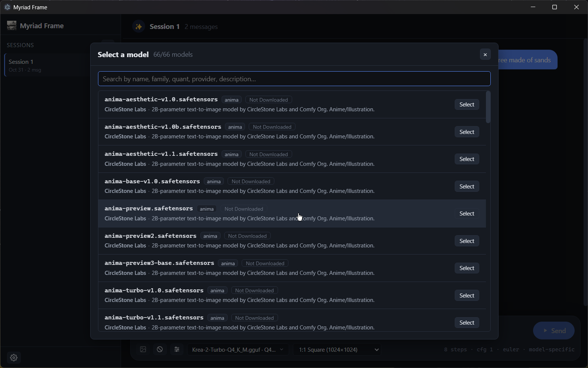<figcaption style="font-size:12px;color:#666;margin-top:4px;">Model picker</figcaption></figure>
  <figure style="margin:0">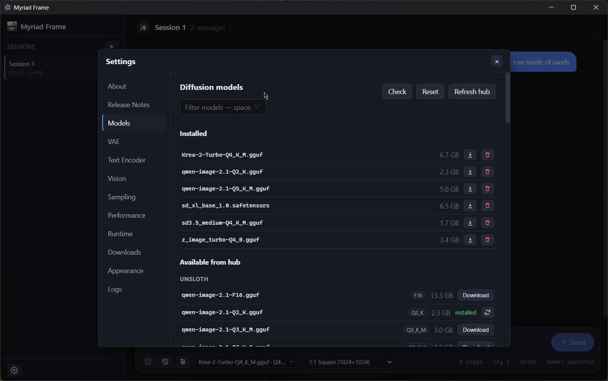<figcaption style="font-size:12px;color:#666;margin-top:4px;">Model management</figcaption></figure>
  <figure style="margin:0">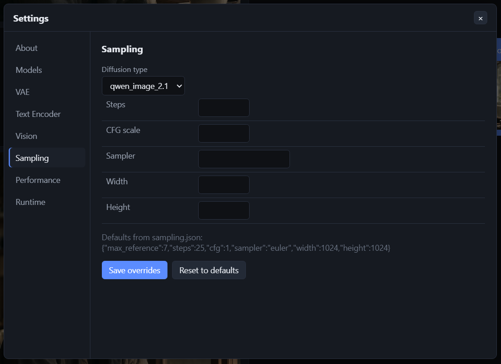<figcaption style="font-size:12px;color:#666;margin-top:4px;">Sampling settings</figcaption></figure>
  <figure style="margin:0">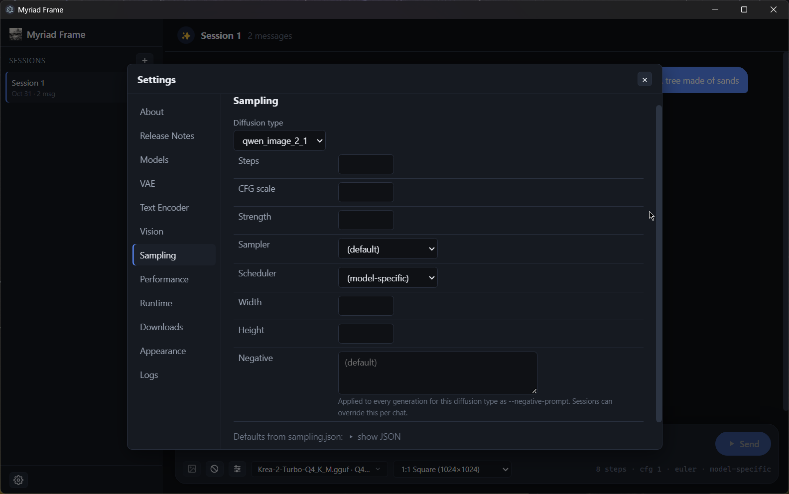<figcaption style="font-size:12px;color:#666;margin-top:4px;">Improved sampling settings</figcaption></figure>
  <figure style="margin:0">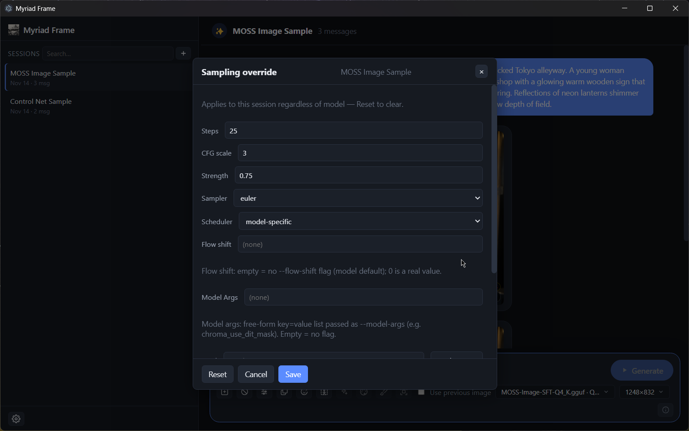<figcaption style="font-size:12px;color:#666;margin-top:4px;">Sampling override</figcaption></figure>
  <figure style="margin:0">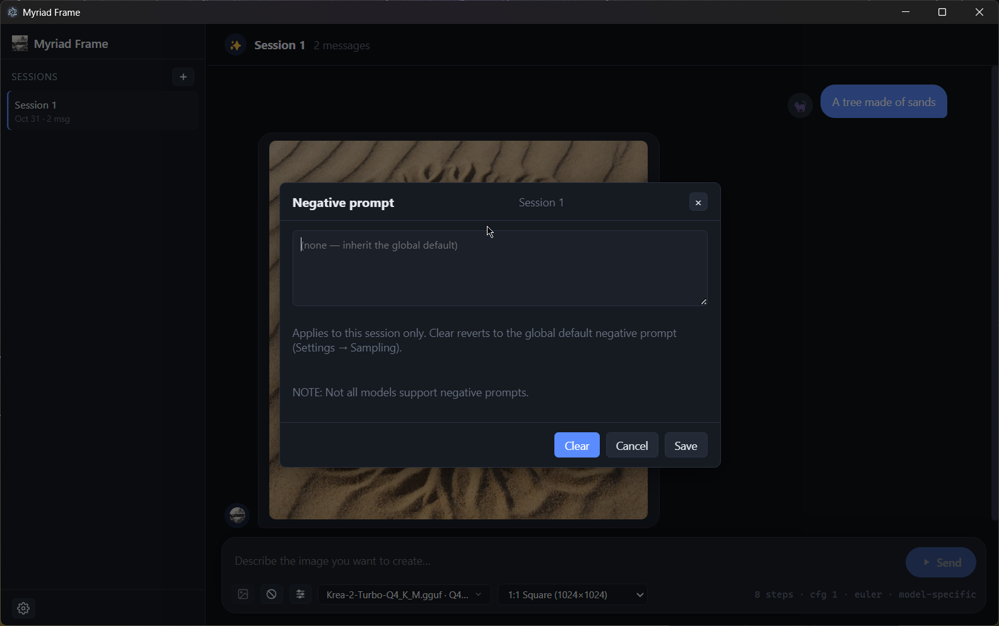<figcaption style="font-size:12px;color:#666;margin-top:4px;">Negative prompt</figcaption></figure>
  <figure style="margin:0">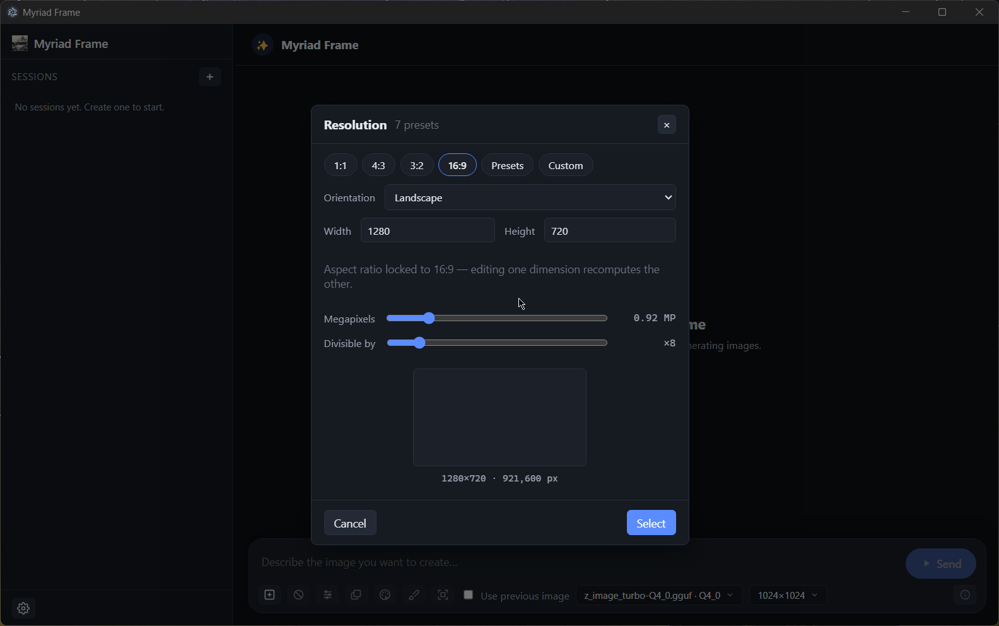<figcaption style="font-size:12px;color:#666;margin-top:4px;">Resolution selector</figcaption></figure>
  <figure style="margin:0">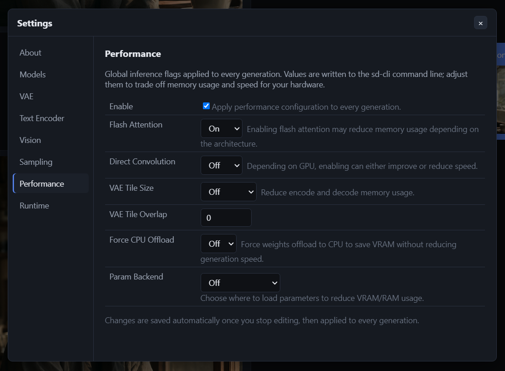<figcaption style="font-size:12px;color:#666;margin-top:4px;">Performance settings</figcaption></figure>
  <figure style="margin:0">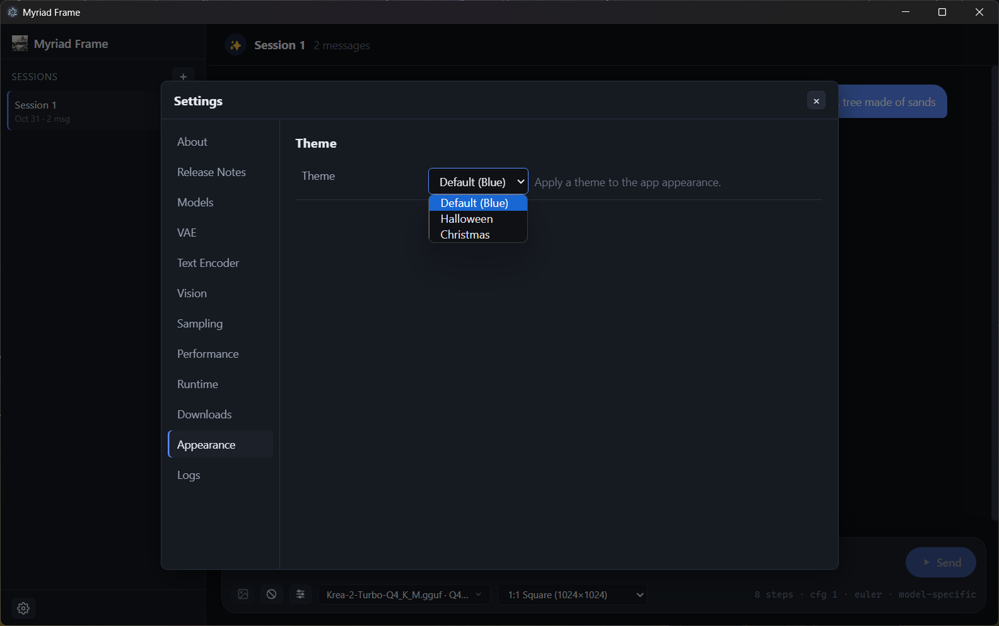<figcaption style="font-size:12px;color:#666;margin-top:4px;">Appearance settings</figcaption></figure>
  <figure style="margin:0">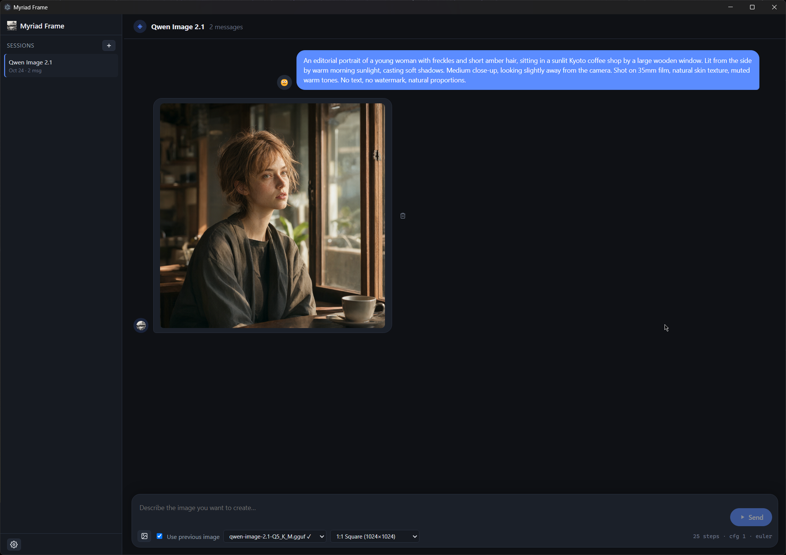<figcaption style="font-size:12px;color:#666;margin-top:4px;">Qwen Image 2.1 — generation</figcaption></figure>
  <figure style="margin:0">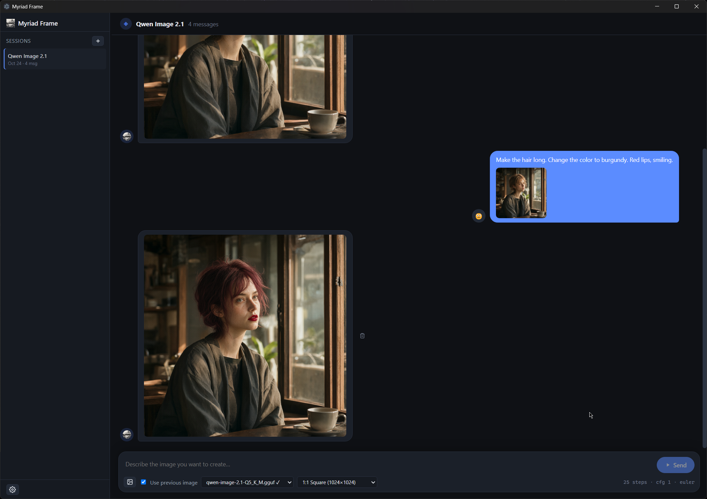<figcaption style="font-size:12px;color:#666;margin-top:4px;">Qwen Image 2.1 — editing</figcaption></figure>
  <figure style="margin:0">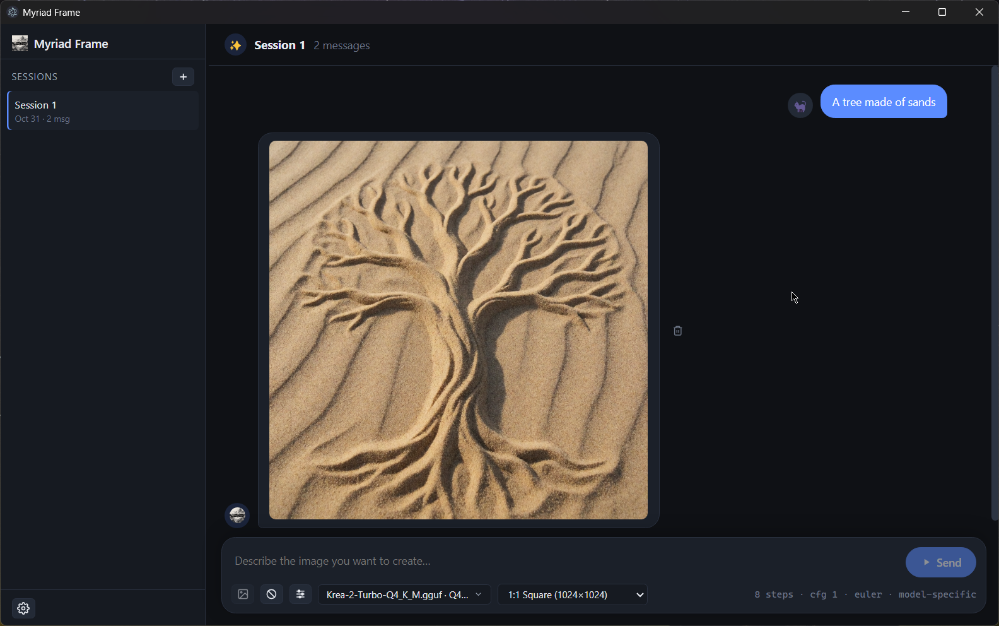<figcaption style="font-size:12px;color:#666;margin-top:4px;">Krea</figcaption></figure>
  <figure style="margin:0">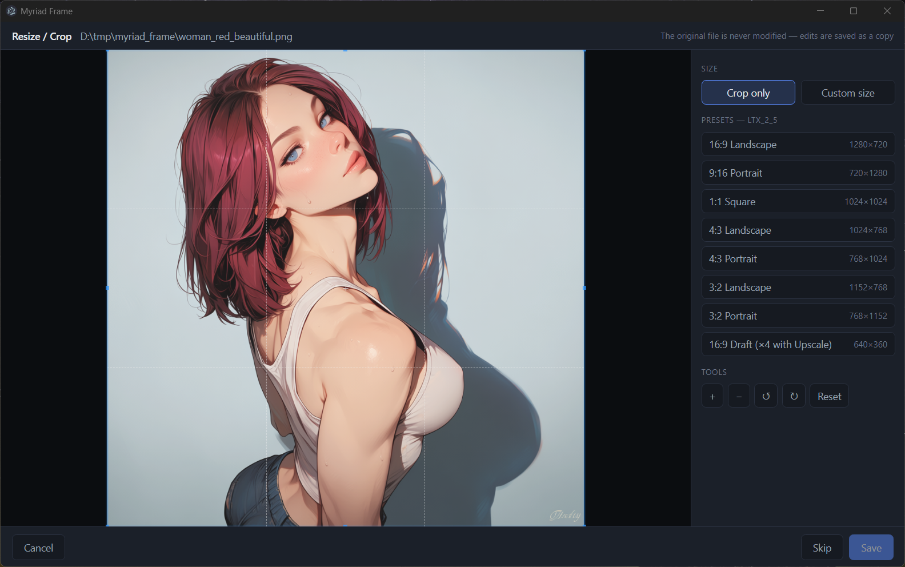<figcaption style="font-size:12px;color:#666;margin-top:4px;">Resize / Crop — crop only</figcaption></figure>
  <figure style="margin:0">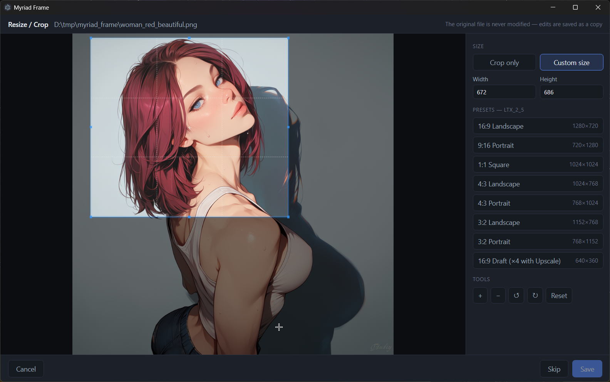<figcaption style="font-size:12px;color:#666;margin-top:4px;">Resize / Crop — custom size</figcaption></figure>
</div>

## How generation works

When you click **Generate**, the main process:
1. Resolves the selected runtime's `sd-cli` binary from `data/runtime/<version>/`.
2. Builds the argument list from your prompt, the sampling defaults (steps/cfg/sampler),
   the chosen resolution, and the model/VAE/encoder paths.
3. Spawns `sd-cli`, streams step progress to the chat, and writes the result to `data/output/`.
4. The **Stop** button terminates the running process.

> The exact `sd-cli` flags are finalized against a downloaded runtime (`sd-cli --help`).
> See the `sdcli` service in `src/main/services/sdcli.ts`.

## Project structure

```
configurations/            # JSON source of truth
shared/types.ts            # shared TypeScript types (main <-> preload <-> renderer)
src/
  main/                    # Electron main process
    index.ts               # window + init pipeline
    ipc.ts                 # all IPC handlers
    services/              # config, platform, download, runtime, hub, settings, models, sessions, sdcli
  preload/index.ts         # typed contextBridge API (window.api)
  renderer/                # Vue 3 app
    index.html
    src/
      App.vue              # layout: sidebar + chat + settings + init overlay
      components/          # Sidebar, ChatPanel, SettingsDialog, InitOverlay, Toasts, ImageFromPath
      stores/              # Pinia stores (app, sessions, settings)
      styles/theme.css
```

## Troubleshooting

### Error: Dependency download error for `Z-Image Turbo`

```
Error occurred in handler for 'models:download': Error: Download failed: HTTP 401 for https://huggingface.co/black-forest-labs/FLUX.1-schnell/resolve/main/vae/diffusion_pytorch_model.safetensors
```

**Solution:**
Manually download https://huggingface.co/black-forest-labs/FLUX.1-schnell/resolve/main/vae/diffusion_pytorch_model.safetensors and place it in: `%AppData%\Roaming\myriad_frame\data\models\vae\black_forest_labs\`
