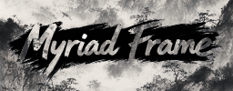
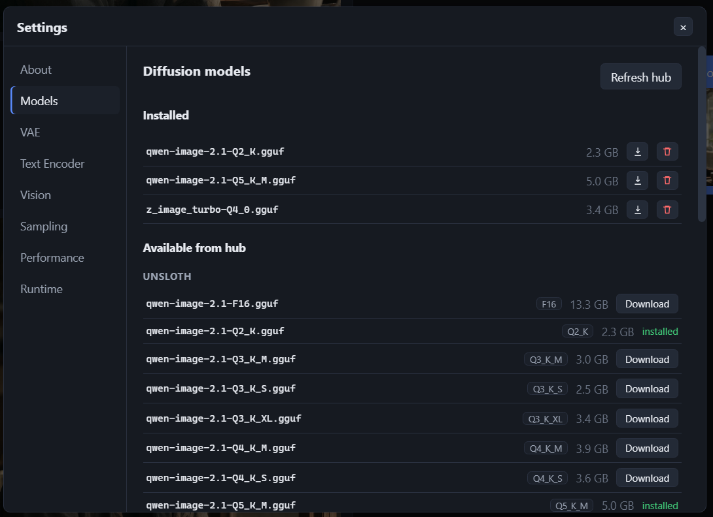
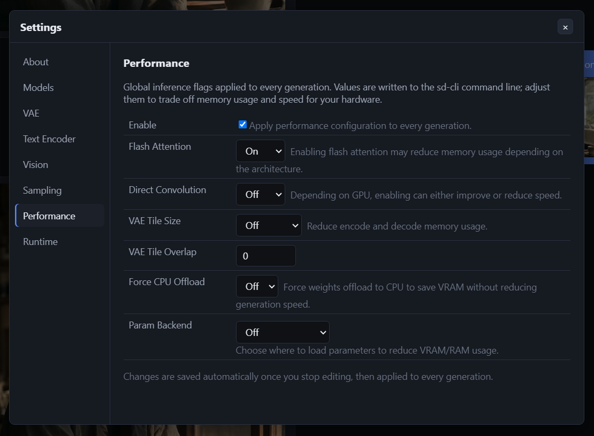
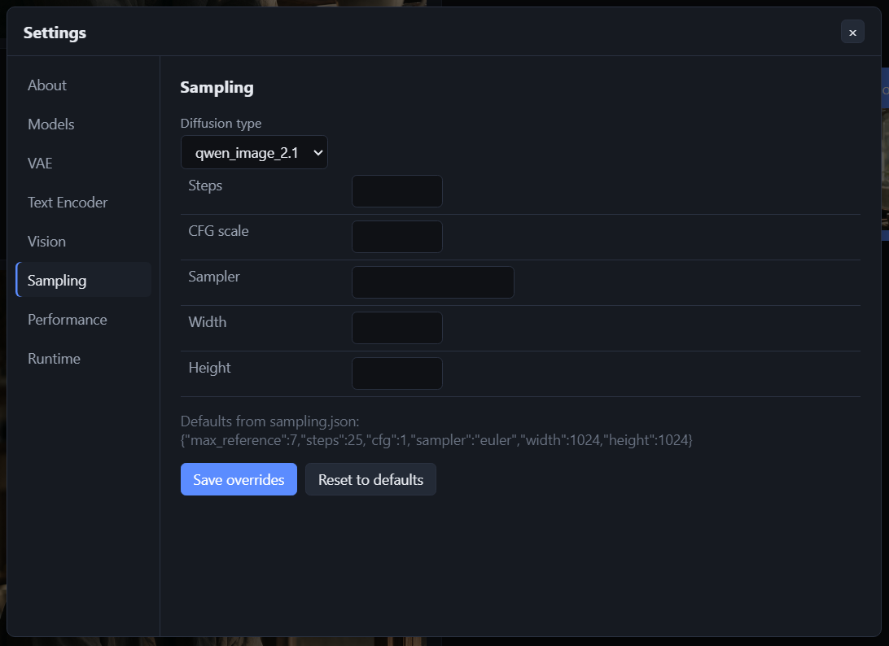
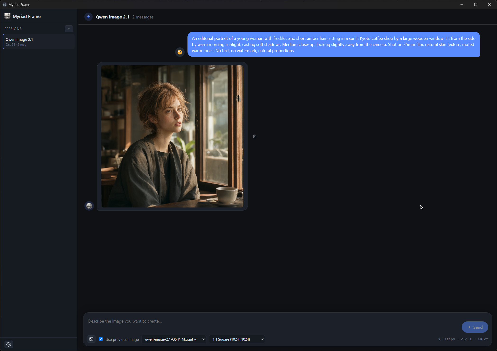
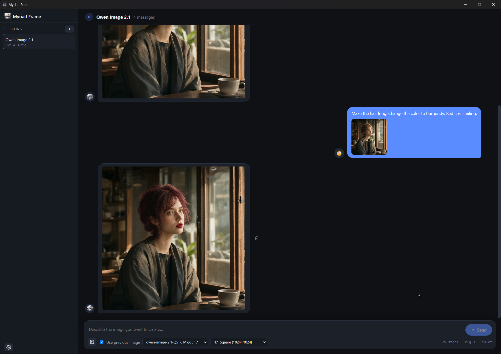

# Myriad Frame



An Electron + Vue 3 + TypeScript desktop front-end that uses [`stable-diffusion.cpp`](https://github.com/leejet/stable-diffusion.cpp) as its runtime provider. It manages sessions, downloads and selects models (diffusion / VAE / text encoder) from curated Hugging Face repositories, and drives image generation through the bundled `sd-cli` runtime.

## Support

Myriad Frame is a free, open-source project. If you find it useful and would like to support its development, you can buy me a coffee:

[](https://buymeacoffee.com/lemuel.raganas)

## Runtime & Model Providers

- **Runtime**: [`stable-diffusion.cpp`](https://github.com/leejet/stable-diffusion.cpp) by @leejet — a C++ port of Stable Diffusion, optimized for speed and low memory usage.
- **Model Providers**:
  - **[unsloth](https://huggingface.co/unsloth)** — High-quality quantized LLM and diffusion models.
  - **[abenzerps](https://huggingface.co/abenzerps)** — Curated diffusion model quantizations.

## Prerequisites

- **Node.js 20+** and **npm**
- A GPU is recommended (NVIDIA CUDA or Vulkan). CPU-only runs are supported but slow.

## Setup

```bash
npm install
```

> The `electron` postinstall downloads the Electron binary. If your environment sets
> `ELECTRON_RUN_AS_NODE=1`, unset it before running the app, otherwise `electron.exe`
> boots as plain Node and the main process will crash.

## Run (development)

```bash
npm run dev
```

On first launch the app shows an **Initializing** overlay while it:
1. Detects your platform/GPU and picks a recommended runtime key.
2. Downloads the selected `sd-cli` runtime into `data/runtime/<version>/` (if missing).
3. Scans the Hugging Face repos from `configurations/hub.json` to build a cached
   catalog of available quantizations at `data/cache/hub-catalog.json` (only when no
   cache exists yet).

## Build (production)

```bash
npm run build
```

Outputs to `out/` (main, preload, renderer). Use `electron-builder` (not configured here)
to package a distributable installer.

## Typecheck

```bash
npm run typecheck
```

## Configuration (source of truth)

All behavior is driven by JSON files in `configurations/`:

| File | Purpose |
|------|---------|
| `hub.json` | Repo URLs for VAE, text encoder, and diffusion models. Used to build the downloadable quant catalog. |
| `sampling.json` | Default sampling per `diffusion_type` (`steps`, `cfg`, `sampler`, `width`, `height`, `max_reference`). |
| `resolution.json` | Supported resolutions per `diffusion_type` (populates the resolution dropdown). |
| `runtime.json` | `sd-cli` runtime versions and per-platform download URLs. |

## Roadmap

Planned directions for future releases (in rough priority order):

- **Better session & chat management** — richer session organization: folders/tags, search & filter, drag-and-drop reordering, message-level actions (edit, regenerate, copy), threaded replies, and import/export of sessions.
- **Expanded supported diffusion models** — broaden the curated Hugging Face catalog, add first-run model discovery, and improve quantization/version selection.
- **LoRA support & management** — load and mix LoRAs per generation, with a management UI to browse, download, enable/disable, and tune per-LoRA weight.
- **ControlNet support & management** — attach ControlNet conditions (pose, depth, canny, etc.) to generations, with a management UI for model and preset selection.
- **IP-Adapter & ADetailer support** — IP-Adapter for reference-image style/fidelity adaptation, and ADetailer for automatic face/hand refinement of generated images, each with its own model management UI.
- **In-built masking & inpainting** — draw/paint a mask directly on the canvas for inpainting, outpainting, and region-based edits without external image editors.
- **Audio generation support** — drive text-to-audio / audio generation runtimes alongside image generation.
- **Video generation support** — generate short clips from prompts (and prompt + reference/image) through supported video runtimes.

## Data layout

All downloaded/generated data lives under `data/`:

```
data/
  models/
    diffusion/   # diffusion model weights (gguf, etc.)
    encoder/     # text encoder weights
    vae/         # VAE weights
  runtime/<version>/   # extracted sd-cli runtime + binary
  output/              # generated images
  sessions/            # one JSON file per chat session
  cache/               # hub-catalog.json
  settings.json        # user settings (default VAE, sampling overrides, selected runtime)
```

## UI

- **Sidebar** — resizable. Header shows the app name; lists sessions (create / rename /
  delete); footer gear icon opens the **Settings** dialog.
- **Chat panel** — the session. Select a model/quant, VAE, text encoder, and resolution;
  add up to `max_reference` reference images; toggle "use previous image as reference"
  (default on). The **Generate** button (play icon) becomes **Stop** (stop icon) while a
  generation is in flight, with a spinner/dot indicator and live step progress.
- **Settings dialog** — sections:
  - **About** — app/runtime/platform/GPU info.
  - **Models** — list, download, and delete models per type.
  - **VAE** — pick the default VAE per `diffusion_type`.
  - **Sampling** — override sampling defaults per `diffusion_type`.
  - **Runtime** — detected platform, recommended runtime, version list with download/select.

## Screenshots

| Model management | Performance settings |
|------------------|----------------------|
|  |  |

| Sampling settings | Generation |
|-------------------|------------|
|  |  |

| Editing with a reference |
|--------------------------|
|  |

## How generation works

When you click **Generate**, the main process:
1. Resolves the selected runtime's `sd-cli` binary from `data/runtime/<version>/`.
2. Builds the argument list from your prompt, the sampling defaults (steps/cfg/sampler),
   the chosen resolution, and the model/VAE/encoder paths.
3. Spawns `sd-cli`, streams step progress to the chat, and writes the result to `data/output/`.
4. The **Stop** button terminates the running process.

> The exact `sd-cli` flags are finalized against a downloaded runtime (`sd-cli --help`).
> See the `sdcli` service in `src/main/services/sdcli.ts`.

## Project structure

```
configurations/            # JSON source of truth
shared/types.ts            # shared TypeScript types (main <-> preload <-> renderer)
src/
  main/                    # Electron main process
    index.ts               # window + init pipeline
    ipc.ts                 # all IPC handlers
    services/              # config, platform, download, runtime, hub, settings, models, sessions, sdcli
  preload/index.ts         # typed contextBridge API (window.api)
  renderer/                # Vue 3 app
    index.html
    src/
      App.vue              # layout: sidebar + chat + settings + init overlay
      components/          # Sidebar, ChatPanel, SettingsDialog, InitOverlay, Toasts, ImageFromPath
      stores/              # Pinia stores (app, sessions, settings)
      styles/theme.css
```

## Troubleshooting

### Error: Dependency download error for `Z-Image Turbo`

```
Error occurred in handler for 'models:download': Error: Download failed: HTTP 401 for https://huggingface.co/black-forest-labs/FLUX.1-schnell/resolve/main/vae/diffusion_pytorch_model.safetensors
```

**Solution:**
Manually download https://huggingface.co/black-forest-labs/FLUX.1-schnell/resolve/main/vae/diffusion_pytorch_model.safetensors and place it in: `%AppData%\Roaming\myriad_frame\data\models\vae\black_forest_labs\`
